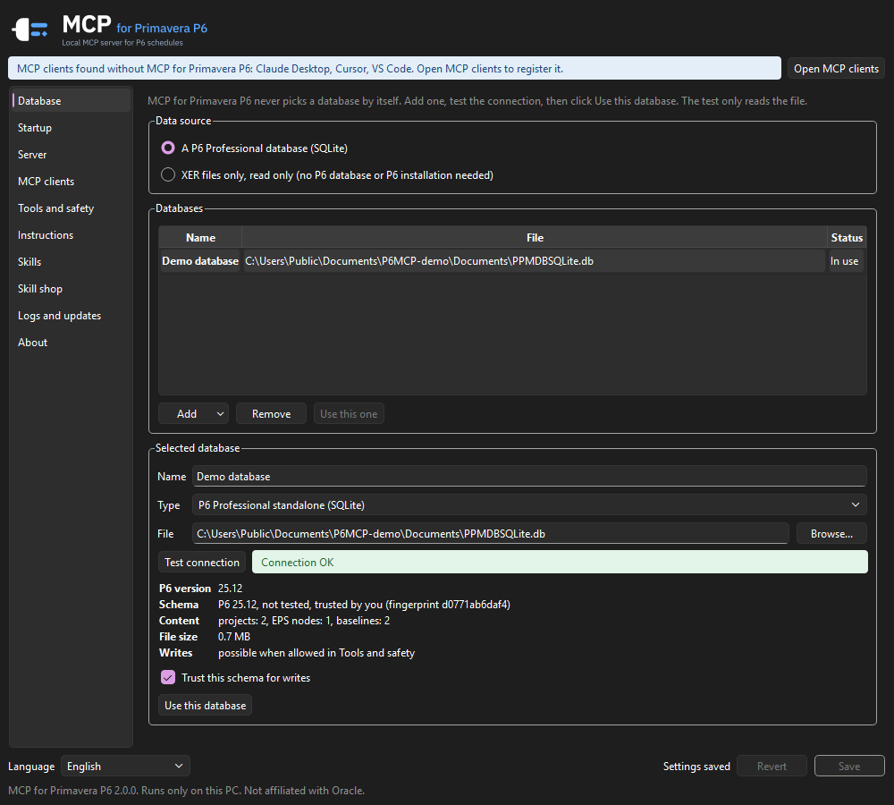
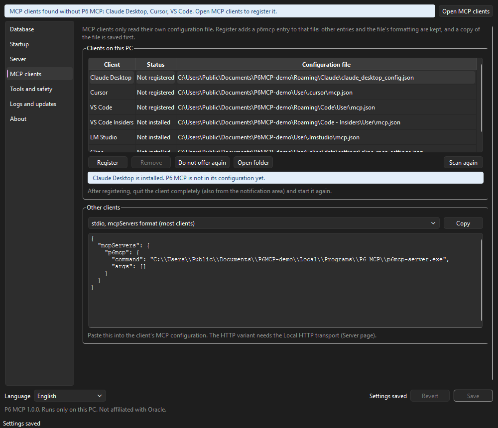
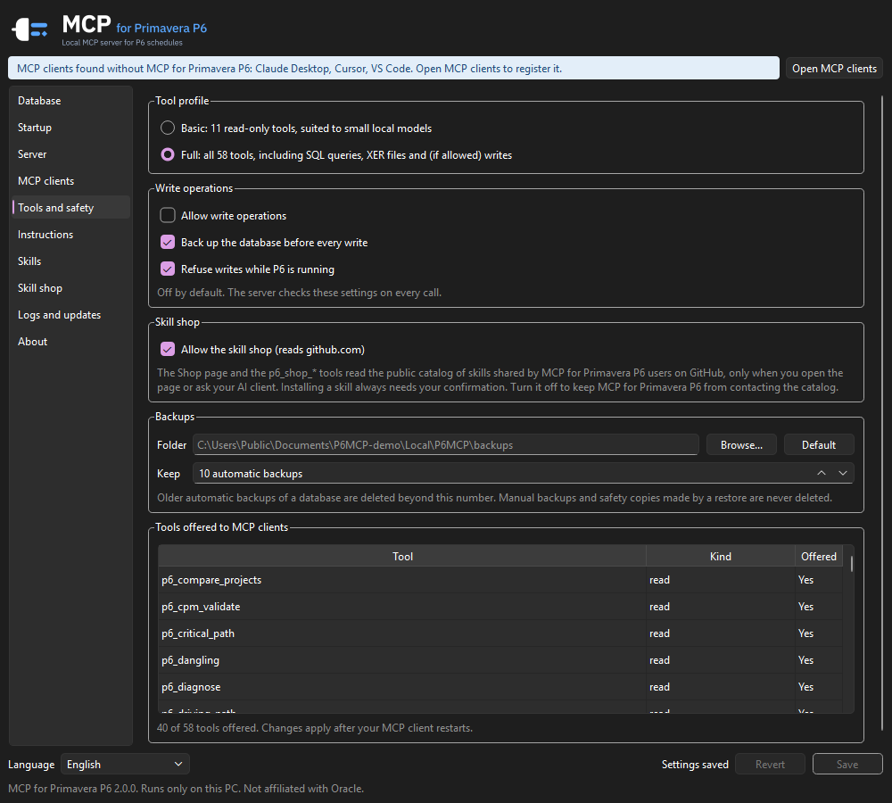

# P6 MCP for Primavera P6

A local [MCP](https://modelcontextprotocol.io) server that lets an AI assistant (Claude Desktop, Cursor,
VS Code, LM Studio, Cline and any other MCP client) analyse, and when you allow it edit, **Primavera P6
Professional** schedules on your Windows PC: a standalone (SQLite) P6 database, or plain XER files.

> P6 MCP is an independent project. It is not affiliated with, endorsed or sponsored by Oracle.
> Oracle, Primavera and P6 are trademarks of Oracle and/or its affiliates.



## What it does

Ask your assistant questions such as "what drives the finish date?", "run a DCMA health check",
"what changed since the last update?" or "what happens if procurement takes four more weeks?". The
server computes the answers; the model explains them.

- **Schedule analysis**: projects and EPS, WBS roll-ups, activities with filters and activity codes,
  relationships with lag calendars, critical path (total float or longest path), driving path, float
  paths, where an activity's float comes from, float distribution, look-ahead windows.
- **Health and progress**: DCMA 14-point check with the project's own P6 thresholds (and comparison over
  time), out-of-sequence progress, dangling and redundant logic, S-curves and earned value at the data
  date, resource and cost summaries, grouping by status, WBS or code.
- **User defined fields (UDFs)**: list the UDF columns with their use, filter activities on UDF values
  and show them as columns.
- **Comparisons and what-if**: compare two updates or a baseline activity by activity and link by link;
  a CPM engine that reproduces P6's F9 on the projects it was checked against, for what-if scenarios
  run in memory, never written.
- **XER files**: inspect, import (new project, baseline, update), export, or analyse XER files alone in
  read-only XER mode, without a P6 database or P6 installed.
- **Edits** (off by default): durations, constraints, actual dates, progress, resource assignment
  units, activity UDF values, relationships, schedule options, deletes, EPS, backups and restore.

## Install

1. Download `P6MCP-Setup-<version>.exe` from [Releases](https://github.com/nizarhamza/p6-mcp/releases)
   and check it against `SHA256SUMS.txt` (`certutil -hashfile P6MCP-Setup-1.0.1.exe SHA256`).
2. Run it. It installs for your Windows user only (no administrator rights, nothing else to install)
   and, on the last page, offers to register P6 MCP with every MCP client it finds. Untick the ones you
   do not want.
3. P6 MCP Settings opens. Under **Database**, pick your P6 database (suggestions come from P6's own
   connection list), click **Test connection** (read only), then **Use this database**, and **Save**.
4. Restart your MCP client completely.

Until you select and test a database, every tool answers "No database configured. Open P6 MCP Settings
to select one."

Release builds are not code signed yet: Windows SmartScreen may warn on first launch ("More info", "Run
anyway"). Check the SHA-256 first.

Other packages on the release page: a **portable zip** (same programs, no installation) and an
**MCP bundle** (`.mcpb`) that Claude Desktop installs in one click (server only; you pick the database in
the extension settings).

## MCP clients



MCP has no automatic discovery: each client reads its own configuration file. P6 MCP adds (or repairs,
or removes) only its own `p6mcp` entry in that file, after a timestamped backup, keeping every other
entry, comment and the file's formatting. It refuses a file it cannot parse.

| Client | Configuration file |
|---|---|
| Claude Desktop | `%APPDATA%\Claude\claude_desktop_config.json` (stdio only) |
| Cursor | `%USERPROFILE%\.cursor\mcp.json` |
| VS Code / VS Code Insiders | `%APPDATA%\Code\User\mcp.json` / `...\Code - Insiders\User\mcp.json` |
| LM Studio | `%USERPROFILE%\.lmstudio\mcp.json` |
| Cline | `%USERPROFILE%\.cline\data\settings\cline_mcp_settings.json` (or the VS Code extension's file) |

The Settings app scans again at every launch and offers to register new clients or repair an entry an
update overwrote. For any other client, **MCP clients > Other clients** gives a configuration snippet
(stdio, local HTTP, or VS Code format) to paste.

From the command line (the installer uses the same commands):

```powershell
& "$env:LOCALAPPDATA\Programs\P6 MCP\p6mcp-server.exe" clients list
& "$env:LOCALAPPDATA\Programs\P6 MCP\p6mcp-server.exe" clients register cursor
```

## Safety



- **Tool profiles**: Basic (11 read-only tools, suited to small local models) or Full (all 51).
- **Writes are off by default.** With the Full profile and "Allow write operations", every write takes
  two calls: a dry run that shows the plan and returns a single-use confirmation token, then, after your
  explicit yes, the same call with that token. Deleting a project or an activity and restoring a backup
  also need a confirmation text. If the database changed in between, the write is refused.
- A **backup** is taken before every write (with a retention you choose), writes are refused while **P6
  is running**, and every write goes to the **edit log** with its parameters.
- Writes are refused on a P6 schema version P6 MCP was not tested with, unless you trust it explicitly.
- These rules are enforced by the server itself on every call, not only by the Settings window.

Writes go straight to the database and **bypass P6's own application logic**. P6 MCP updates the audit
fields (`update_date`, `update_user`, `create_*`) the way P6 does and never writes planned, early or late
dates or float: close P6 before writing, then open it and press **F9**. See [SECURITY.md](SECURITY.md)
for the list of what the write tools can change.

## Privacy

P6 MCP runs **only on your PC**: no cloud component, no telemetry. Its only network request is the
optional update check (GitHub releases), which you can turn off under **Logs and updates**.

**The data returned by the tools goes to the AI model your MCP client uses**, which may be a cloud
service. For confidential schedules, use a local model (for example in LM Studio).

## Local HTTP transport

By default each client starts its own server (stdio). Under **Server** you can switch to a local HTTP
server, hosted by the notification area app, for clients that need HTTP or to share one server:

- listens on `127.0.0.1` only (`http://127.0.0.1:<port>/mcp`), with a port check;
- every request needs `Authorization: Bearer <token>`; the token lives in the Windows Credential Manager
  (shown masked, copy, regenerate);
- Host and Origin headers are checked to block DNS rebinding.

## XER-only mode

Under **Database > Data source**, choose **XER files only**, add one or more XER files and click **Load
and check**. The files are read into a private read-only copy; every read tool works on it. Load two
updates of the same schedule to compare them: a Project ID already used by the first file gets a `~2`
suffix.

## Tested versions

| Component | Tested |
|---|---|
| Windows | Windows 11 |
| P6 Professional standalone (SQLite) | 25.12 (schema fingerprint in `p6mcp/schema.py`); other versions are read only until tested or trusted |
| XER files | written by P6 Professional 24.12, and by P6 MCP's own export |
| MCP clients | registration tested on sample configuration files of every client listed above; stdio and HTTP tested with the MCP Python SDK client; end-to-end use with each client is in the release checklist |
| MCP SDK | mcp 2.3 (1.8 or later supported) |

SQL Server and Oracle P6 databases (P6 EPPM, or P6 Professional with a server database) are not supported.

## Troubleshooting

- **"No database configured"**: open P6 MCP Settings, select a database, Test connection, Use this
  database, Save.
- **A tool is "not available in the Basic profile"**: switch to Full under Tools and safety, Save, restart
  the client.
- **The client does not show the tools**: restart it completely (also from the notification area), then
  check **MCP clients**: the entry may need Repair. Ask the assistant to run `p6_diagnose`.
- **"P6 (PM.exe) is running"**: close P6 before a write.
- **"Unknown P6 schema"**: your P6 version was not tested; reads work. You can trust the schema under
  Database (after a backup).
- **HTTP server error**: Server shows the last error (often a port in use: pick another one).
- Logs: **Logs and updates > Open log folder** (`%LOCALAPPDATA%\P6MCP\logs`). Settings live in
  `%APPDATA%\P6MCP\config.json`; backups, edit log and XER copies in `%LOCALAPPDATA%\P6MCP`.

## Uninstall

Windows Settings > Apps > P6 MCP for Primavera P6. The uninstaller removes the program, the `p6mcp`
entries from your MCP clients and the startup entry. Your settings, backups and logs are kept.

## Development

```powershell
python -m venv .venv
.venv\Scripts\pip install -e .[dev]
.venv\Scripts\python -m pytest -q
.venv\Scripts\python -m p6mcp.settings_app      # Settings window
```

Tests run on a synthetic P6 database and synthetic XER files built by the tests
(`tests/fixtures/make_db.py`). Never commit a real schedule, database, XER file or log. Building the
installer and releasing: [docs/RELEASING.md](docs/RELEASING.md).

## License

[Apache License 2.0](LICENSE). Copyright 2026 Nizar Hamza. See [NOTICE](NOTICE).
