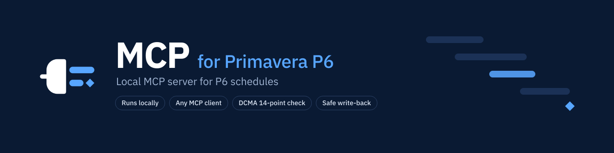
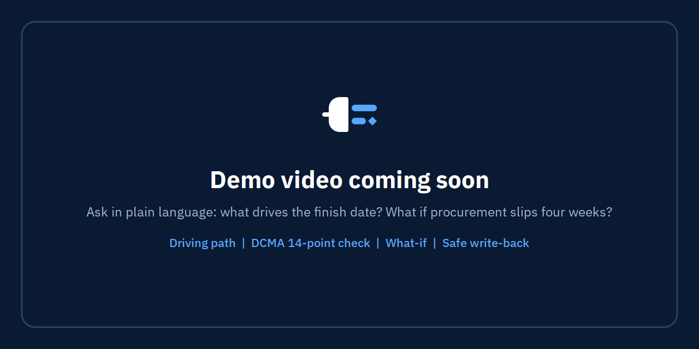

<!-- mcp-name: io.github.nizarhamza/mcp-for-primavera-p6 -->


[](https://github.com/nizarhamza/mcp-for-primavera-p6/releases/latest)
[](LICENSE)

[](https://m8ven.ai/mcp/nizarhamza-p6-mcp-151l9d?s=readme)

# MCP for Primavera P6: Primavera P6 MCP Server

**MCP for Primavera P6** is a local [Model Context Protocol (MCP)](https://modelcontextprotocol.io) server that
connects Claude, ChatGPT, Cursor, VS Code and any other MCP client to your **Oracle Primavera P6 Professional**
schedules on Windows. It reads the P6 database itself (P6 Professional standalone, SQLite) or plain **XER files**
and answers scheduling questions with real computations: critical path and driving path, total float, the
**DCMA 14-point check**, look-ahead, baseline and update comparison, CPM what-if and Monte Carlo schedule risk.
Unlike XER-only MCP servers, it can also **write changes back to the P6 database**: durations, logic,
constraints, actuals, units and UDFs, each one previewed in a dry run, applied only after your confirmation,
backed up first and recorded in an edit log.

> MCP for Primavera P6 is an independent project. It is not affiliated with, endorsed or sponsored by Oracle.
> Oracle, Primavera and P6 are trademarks of Oracle and/or its affiliates.

<!-- DEMO GIF PLACEHOLDER: record a 20 to 40 second capture (see LAUNCH_CHECKLIST.md), save it as
     docs/images/demo.gif and point the image below at it. -->


**Contents:** [What it does](#what-it-does) · [Install](#install) · [Connect your MCP client](#connect-your-mcp-client) ·
[Tools](#tools) · [Compared with XER-only servers](#compared-with-xer-only-mcp-servers) · [Safety](#safety) ·
[Privacy](#privacy) · [P6 skills](#p6-skills) · [FAQ](#faq) · [Troubleshooting](#troubleshooting)

## What it does

Ask your assistant "what drives the finish date?", "run a DCMA health check on the March update", "what changed
since the last update?" or "what happens if procurement takes four more weeks?". The server computes the answer
from the schedule; the model explains it. Dates and float come from P6's last schedule run (F9).

- **Schedule analysis**: projects and EPS, WBS roll-ups, activities filtered by status, float, dates, activity
  codes or UDFs, relationships with the project's lag calendar rule, critical path (total float or longest path),
  driving path, float paths, where an activity's float comes from, float distribution, look-ahead windows.
- **Schedule quality**: DCMA 14-point check with the project's own P6 thresholds, logic density and a weighted
  grade, comparison with earlier checks, out-of-sequence progress, dangling ends, redundant links.
- **Comparisons, what-if and risk**: two updates or a baseline compared activity by activity and link by link,
  with slip causes and float erosion; an integrity review of an update against the previous one (questions to
  raise, not proof); a CPM engine checked against P6's F9 (`p6_cpm_validate` reports the match) for what-if
  scenarios and Monte Carlo risk, run in memory and never written.
- **Progress and reporting**: S-curves and earned value at the data date, resource and cost summaries, groups by
  status, WBS or code, and a one-page **Excel dashboard** with native charts.
- **XER files**: inspect, import (new project, baseline, update), export, or analyse XER files alone in XER-only
  mode, without a P6 database or P6 installed.
- **Edits** (off by default): durations, constraints, actual dates, physical % complete, resource assignment
  units, activity UDF values, relationships, schedule options, EPS, deletes, backups and restore.

## Install

MCP for Primavera P6 runs on Windows 10 or 11, next to P6 Professional. Nothing else to install: Python is
bundled.

1. Download `P6MCP-Setup-<version>.exe` from
   [Releases](https://github.com/nizarhamza/mcp-for-primavera-p6/releases/latest) and check it against
   `SHA256SUMS.txt` (`certutil -hashfile P6MCP-Setup-2.0.0.exe SHA256`).
2. Run it. It installs for your Windows user only (no administrator rights) and, on its last page, offers to
   register the server with every MCP client it finds (Claude Desktop, Claude Code, Cursor, VS Code, LM Studio,
   Cline). Untick the ones you do not want.
3. **MCP for Primavera P6 Settings** opens. Under **Database**, pick your P6 database (suggestions come from
   P6's own connection list), click **Test connection** (read only), then **Use this database**, and **Save**.
   The server never picks a database by itself: until you do this, every tool answers "No database configured".
4. Restart your MCP client completely.

Release builds are not code signed yet: Windows SmartScreen may warn on first launch ("More info", "Run anyway").
Check the SHA-256 first. Other packages on the release page: a **portable zip** (no installation) and an
**MCP bundle** (`.mcpb`, server only) that Claude Desktop installs in one click; it is also the package listed in
the [official MCP Registry](https://registry.modelcontextprotocol.io) as
`io.github.nizarhamza/mcp-for-primavera-p6`.

## Connect your MCP client

The installer and **Settings > MCP clients** write the client configuration for you: they add (or repair, or
remove) only the `p6mcp` entry, after a timestamped backup, keeping every other entry, comment and the file's
formatting. The manual steps below are for reference. In every snippet, replace `<you>` with your Windows user
name (or copy the snippet from **Settings > MCP clients > Other clients**, which fills in the real path).

### Claude Desktop

Either let the installer register it, or double-click the `.mcpb` bundle (Settings > Extensions shows it; pick
the database there), or edit `%APPDATA%\Claude\claude_desktop_config.json`:

```json
{
  "mcpServers": {
    "p6mcp": {
      "command": "C:\\Users\\<you>\\AppData\\Local\\Programs\\P6 MCP\\p6mcp-server.exe",
      "args": []
    }
  }
}
```

Quit Claude Desktop completely (also from the notification area) and start it again. The P6 skills appear as
prompts in the **+** menu.

### Cursor

The installer registers it in `%USERPROFILE%\.cursor\mcp.json`, or add the same `mcpServers` entry as Claude
Desktop above to that file. Cursor lists the tools under Settings > MCP.

### VS Code (GitHub Copilot agent mode)

The installer registers it in `%APPDATA%\Code\User\mcp.json` (VS Code Insiders: `...\Code - Insiders\User\mcp.json`).
By hand, run **MCP: Open User Configuration** and add:

```json
{
  "servers": {
    "p6mcp": {
      "type": "stdio",
      "command": "C:\\Users\\<you>\\AppData\\Local\\Programs\\P6 MCP\\p6mcp-server.exe",
      "args": []
    }
  }
}
```

Then open Copilot Chat in **Agent** mode and pick the tools from the tools menu.

### ChatGPT

ChatGPT cannot start a program on your PC, so there are two routes. Neither is tested by the maintainer yet:
please report how it goes in an issue.

- **Codex** (in the ChatGPT desktop app, or the Codex CLI) starts local MCP servers from
  `%USERPROFILE%\.codex\config.toml`:

  ```toml
  [mcp_servers.p6mcp]
  command = 'C:\Users\<you>\AppData\Local\Programs\P6 MCP\p6mcp-server.exe'
  args = []
  ```

- **ChatGPT chat** reaches MCP servers over HTTPS only. OpenAI's
  [Secure MCP Tunnel](https://developers.openai.com/api/docs/guides/secure-mcp-tunnels) runs a small client on
  your PC that starts the server (stdio command above) and forwards ChatGPT's requests to it, without opening
  an inbound port; you then add a custom MCP server in ChatGPT with **Tunnel** as the connection. It needs an
  OpenAI platform API key and a ChatGPT plan or workspace that allows custom MCP servers. The tool results then
  pass through OpenAI's service, like any ChatGPT conversation.

### Claude Code, LM Studio, Cline and other clients

The installer registers Claude Code (`%USERPROFILE%\.claude.json`), LM Studio (`%USERPROFILE%\.lmstudio\mcp.json`)
and Cline as well. For Claude Code by hand:

```powershell
claude mcp add --scope user p6mcp -- "$env:LOCALAPPDATA\Programs\P6 MCP\p6mcp-server.exe"
```

Any other client that starts stdio servers takes the `mcpServers` snippet above. Clients that need HTTP can use
the [local HTTP transport](#local-http-transport). From the command line (the installer uses the same commands):

```powershell
& "$env:LOCALAPPDATA\Programs\P6 MCP\p6mcp-server.exe" clients list
& "$env:LOCALAPPDATA\Programs\P6 MCP\p6mcp-server.exe" clients register cursor
```


## Tools

<!-- tools:start -->
58 tools: 37 read-only (11 of them in the Basic profile), 2 that write a file, 18 write tools (off by default; a dry run, then your confirmation; a backup first) and 1 that changes the app's own settings. Generated from the code by `tools/gen_docs.py`.

**Projects and structure**

| Tool | What it does | Access | Basic |
|---|---|---|---|
| `p6_list_projects` | Projects with data date, start, finish, status, baseline and EPS; filter by EPS | Read | yes |
| `p6_list_eps` | EPS tree with depth, path and project counts | Read |  |
| `p6_project_summary` | One-call overview: dates, activity counts, critical counts, % complete by units, physical and duration, baseline variance and SPI | Read | yes |
| `p6_list_wbs` | WBS tree in P6 order with roll-ups: activities, dates, float, units % and baseline planned % | Read | yes |
| `p6_list_calendars` | Calendars with work week, hours per day and holiday exceptions | Read |  |
| `p6_list_udfs` | User defined fields (UDF columns) with how much each one is used | Read |  |
| `p6_schedule_options` | Schedule options of a project, of an XER file, or both side by side | Read |  |

**Activities and relationships**

| Tool | What it does | Access | Basic |
|---|---|---|---|
| `p6_query_activities` | Search activities by name, Activity ID, WBS, status, total float, dates, activity code or UDF, with chosen columns | Read | yes |
| `p6_get_activity` | Everything about one activity: dates, durations, float, constraints, logic, resources, codes, UDFs, notebooks | Read | yes |
| `p6_get_relationships` | Predecessors and successors of an activity, lags in hours and days | Read | yes |
| `p6_lookahead` | What starts, finishes or is in progress in the next weeks, critical work flagged | Read | yes |
| `p6_milestones` | Milestones against the baseline: variance in working and calendar days, float, critical | Read |  |

**Critical path and float**

| Tool | What it does | Access | Basic |
|---|---|---|---|
| `p6_critical_path` | Critical activities as the project defines them (total float or longest path) | Read | yes |
| `p6_driving_path` | The chain of driving predecessors behind an activity's dates, back to its root cause | Read |  |
| `p6_float_paths` | Float paths of the last P6 schedule run, in P6 order | Read |  |
| `p6_float_origin` | Where an activity's total float comes from: the successor chain that sets its late dates | Read |  |
| `p6_float_analysis` | Total and free float distribution by range | Read | yes |

**Schedule quality**

| Tool | What it does | Access | Basic |
|---|---|---|---|
| `p6_health_check` | DCMA 14-point check (the project's own P6 thresholds when set), critical path test, CPLI, BEI and a weighted score | Read | yes |
| `p6_health_check_compare` | Health check now against an earlier run: what got better or worse | Read |  |
| `p6_dangling` | Open starts and open finishes, each with a suggested link to close it | Read |  |
| `p6_redundant_links` | Links that are candidates for removal (transitive, duplicate, to completed work) | Read |  |
| `p6_progress_check` | Out-of-sequence progress and status inconsistencies | Read |  |

**Progress and reporting**

| Tool | What it does | Access | Basic |
|---|---|---|---|
| `p6_progress_curve` | S-curve by month or week (units or cost) against the baseline, earned value at the data date | Read |  |
| `p6_group_summary` | Activities, units and dates grouped by status, type, WBS level or activity code | Read |  |
| `p6_resource_summary` | Units and costs per resource, and activities per status | Read |  |
| `p6_export_dashboard` | Excel project controls dashboard: one A3 page with charts, plus detail sheets | Writes a file |  |

**Comparison, what-if and risk**

| Tool | What it does | Access | Basic |
|---|---|---|---|
| `p6_compare_projects` | Two updates or a baseline compared activity by activity and link by link, with slip causes and float erosion | Read |  |
| `p6_update_integrity` | Review of an update against the previous one: changes a reviewer should question | Read |  |
| `p6_cpm_validate` | Runs the built-in CPM engine and compares it with P6's last F9, activity by activity | Read |  |
| `p6_schedule_whatif` | What-if in memory: add or remove links, change durations or constraints, see the new finish | Read |  |
| `p6_schedule_risk` | Monte Carlo schedule risk in memory: finish percentiles, on-time probability, criticality index | Read |  |

**XER files**

| Tool | What it does | Access | Basic |
|---|---|---|---|
| `p6_inspect_xer` | Reads an XER file without importing it and runs the import pre-flight checks | Read |  |
| `p6_import_xer` | Imports an XER as a new project, a baseline or an update of an existing project | Write |  |
| `p6_export_xer` | Exports a project to an XER file, schedule options included | Writes a file |  |

**Edits (off by default)**

| Tool | What it does | Access | Basic |
|---|---|---|---|
| `p6_update_activity` | Edits an activity: name, durations, constraint, actual dates, physical % complete | Write |  |
| `p6_update_assignment` | Sets budgeted, actual or remaining units of one resource assignment | Write |  |
| `p6_update_assignments` | Sets the units of many assignments in one all-or-nothing change | Write |  |
| `p6_update_udf` | Sets or clears one activity UDF value | Write |  |
| `p6_update_udfs` | Sets or clears many activity UDF values in one change | Write |  |
| `p6_add_relationship` | Adds a relationship (FS, SS, FF, SF, with lag) | Write |  |
| `p6_add_relationships` | Adds many relationships in one all-or-nothing change | Write |  |
| `p6_update_relationship` | Changes the type or lag of a relationship | Write |  |
| `p6_update_relationships` | Changes many relationships in one change | Write |  |
| `p6_delete_relationship` | Deletes a relationship | Write |  |
| `p6_delete_relationships` | Deletes many relationships in one change | Write |  |
| `p6_set_schedule_options` | Writes a project's schedule options, or copies them from an XER file | Write |  |
| `p6_create_eps` | Creates an EPS node | Write |  |
| `p6_delete_activity` | Deletes an activity and everything attached to it, as P6 does | Delete or replace |  |
| `p6_delete_project` | Deletes one or more projects, as P6 does | Delete or replace |  |

**Backups, log and diagnostics**

| Tool | What it does | Access | Basic |
|---|---|---|---|
| `p6_backup_database` | Takes a backup of the P6 database now | Write |  |
| `p6_list_backups` | Lists the backups, automatic (before writes) and manual | Read |  |
| `p6_restore_backup` | Puts a backup back in place, after a safety backup of the current database | Delete or replace |  |
| `p6_edit_log` | Every confirmed write, with its parameters, before and after values | Read |  |
| `p6_diagnose` | Configuration, database, P6 version and P6 running state at a glance | Read | yes |
| `p6_sql_select` | Read-only SQL on the P6 database, as a last resort | Read |  |

**Skill shop**

| Tool | What it does | Access | Basic |
|---|---|---|---|
| `p6_shop_search` | Searches the skill shop (ready-made P6 workflows shared on GitHub) | Read |  |
| `p6_shop_get` | Shows one skill of the shop in full | Read |  |
| `p6_shop_install` | Installs or updates a skill from the shop, after your confirmation | App settings |  |
<!-- tools:end -->

## Compared with XER-only MCP servers

Several MCP servers read Primavera P6 **XER files**; some can also edit an XER and export a new one to import
back into P6. MCP for Primavera P6 works on the **P6 Professional database itself**, and reads XER files too.

| | MCP for Primavera P6 | Typical XER-file MCP server |
|---|---|---|
| Reads XER files | Yes: inspect, import, export, XER-only mode | Yes |
| Reads the P6 Professional database directly (every project, baselines, EPS, codes, UDFs, schedule options) | Yes | No: export an XER first |
| Writes changes back to P6 | Yes, into the database: open P6 and press F9 | No, or edits an XER you import again |
| Preview, confirmation token, backup before each write, restore, edit log | Yes | Not applicable, or varies |
| Refuses to write while P6 is running, or on an untested P6 schema | Yes | Not applicable |
| CPM engine checked against P6's own F9 dates (`p6_cpm_validate`), used for what-if and Monte Carlo risk | Yes | Varies |
| DCMA 14-point check with the thresholds set in P6 | Yes, DCMA defaults when none are set | Varies |
| Excel dashboard, P6 skills (ready-made workflows) | Yes | Varies |
| Installation | Windows installer with a Settings window; registers your MCP clients | Usually a Python package (pip, uvx) |
| Runs on macOS or Linux | No: Windows only, like P6 Professional | Usually yes |
| P6 EPPM, or P6 on SQL Server or Oracle | No | No (XER only) |

"Varies" means some XER servers do it and others do not: check the one you are looking at.

## Safety


- **Tool profiles**: Basic (11 read-only tools, suited to small local models) or Full (all 58).
- **Writes are off by default.** With the Full profile and "Allow write operations", every write takes two calls:
  a dry run that shows the plan and returns a single-use confirmation token, then, after your explicit yes, the
  same call with that token. Deleting a project or an activity and restoring a backup also need a confirmation
  text. If the database changed in between, the write is refused.
- A **backup** is taken before every write (with a retention you choose), writes are refused while **P6 is
  running**, and every write goes to the **edit log** with its parameters.
- Writes are refused on a P6 schema version the server was not tested with, unless you trust it explicitly.
- These rules are enforced by the server itself on every call, not only by the Settings window.

Writes go straight to the database and **bypass P6's own application logic**. The server updates the audit
fields (`update_date`, `update_user`, `create_*`) the way P6 does and never writes planned, early or late dates
or float: close P6 before writing, then open it and press **F9**. See [SECURITY.md](SECURITY.md) for the list of
what the write tools can change.

## Privacy

The server runs **only on your PC**: no cloud component, no telemetry. Its only network requests go to GitHub:
the updates (releases of this repository), which you can turn off under **Logs and updates**, and the skill shop
(reads of its public catalog when you open the Skill shop page or ask for it, at the first start of the Settings
app for the core set, on Restore core skills, and with automatic updates on for newer skill versions), which you
can turn off under **Tools and safety** (the core set then comes from the copy shipped with the app).

**The data returned by the tools goes to the AI model your MCP client uses**, which may be a cloud service. For
confidential schedules, use a local model (for example in LM Studio).

## P6 skills

P6 skills are ready-made workflows that chain the tools into one fixed report: weekly update review, schedule
quality audit, safe update import, update integrity audit, schedule risk, delay what-if, baseline variance, Excel
dashboard and more. They all come from the [skill shop](#skill-shop). At its first start the Settings app installs
the **core set** from the shop (when GitHub cannot be reached, from the copy of the core set shipped with the
app, updated from the shop later). **Restore core skills** (Skills or Skill shop page) installs the core set
again: missing skills come back and edited ones get the shop's version. With automatic updates on (**Logs and
updates**), the tray app also installs newer shop versions of your shop skills, except the ones you edited here:
those show **Update available** on the Skill shop page, and Update asks before replacing your changes.

Most skills need the Full tool profile (the import also needs writes). **MCP clients > Install skills** writes
each one as an [Agent Skills](https://agentskills.io) folder `p6-<name>` (a `SKILL.md` and its reference files);
the client's AI uses a skill when your request matches its description, and Claude Code also runs it as
`/p6-<name>`:

| Client | Skills folder |
|---|---|
| Claude Code, Cursor, VS Code / VS Code Insiders | `%USERPROFILE%\.claude\skills` (one folder read by all three) |
| Cline | `%USERPROFILE%\.cline\skills` |

Update skills refreshes them after an update or a change of the tool settings; Remove skills (and uninstalling)
deletes only the files the app wrote. From the command line:

```powershell
& "$env:LOCALAPPDATA\Programs\P6 MCP\p6mcp-server.exe" clients skills install --detected
```

The server also offers them as MCP prompts: Claude Desktop lists them in the **+** menu, VS Code as
`/mcp.p6mcp.<name>`, Claude Code as `/mcp__p6mcp__<name>`. Claude Desktop has no skills folder: export a skill as
a zip file (**Skills > Export**) and upload it in Claude Desktop's settings to add it as a skill.

The **Skills** page of the Settings app lists them with whether the current tool settings offer them and where
they come from (Shop, Shop edited here, Yours). Turn a skill off, edit it, or add your own (**New**, or **Copy to
my skills** to start from a shop skill): a name, a title, a description that says what it does and when to use it
(clients pick a skill by it), inputs written as `{input}` in the instructions, the P6 tools to use, and up to 5
text reference files (checklists, thresholds, examples; never scripts). The P6 rules are appended to your
instructions. The **Instructions** page shows the instructions every client receives when it connects; turn
built-in lines off (the two-step write rule stays on) or add your own, such as "When you show an activity, write
it as Activity ID - Activity name". Click Save, then Update skills on the MCP clients page, and restart the MCP
client for the prompts.

### Skill shop

The **Skill shop** page lists the P6 skills of the public catalog
[nizarhamza/p6-mcp-shop](https://github.com/nizarhamza/p6-mcp-shop): the core set maintained with the app and the
skills other users shared. Reading it needs no account; the app reads it only when you open the page or ask your
AI client (tools `p6_shop_search`, `p6_shop_get` and `p6_shop_install`, Full profile; an install shows the whole
skill first and needs your confirmation). Read a skill before installing it: it is instructions for the AI, and a
skill that uses write tools can change your schedule once you confirm the change. Turn the shop off under
**Tools and safety**.

To share one of your skills, select it on the Skills page and click **Share on GitHub**: the app copies the skill
to the clipboard and your browser opens the GitHub share form; sign in if asked (a free GitHub account is needed),
paste the skill in the Skill field and click Create (nothing is sent by the app itself). The maintainer reviews
it and, once approved, a GitHub Action checks it and publishes it in the catalog under the Apache-2.0 license.
Without a GitHub account, **Export** the skill to a zip file and send it; **Import** adds a zip (or any skill
folder with a `SKILL.md` and text files) after you review it.

## Local HTTP transport

By default each client starts its own server (stdio). Under **Server** you can switch to a local HTTP server,
hosted by the notification area app, for clients that need HTTP or to share one server:

- listens on `127.0.0.1` only (`http://127.0.0.1:<port>/mcp`), with a port check;
- every request needs `Authorization: Bearer <token>`; the token lives in the Windows Credential Manager (shown
  masked, copy, regenerate);
- Host and Origin headers are checked to block DNS rebinding.

## Excel dashboard

Ask for example "export the dashboard of DEMO-A to D:\Reports\DEMO-A.xlsx" (Full profile). The template is built
into the server: `p6_export_dashboard` reads the last F9 and writes a finished workbook (values and native Excel
charts, no formulas), so press F9 in P6 first. An existing file is replaced only when you say so (`overwrite`).

| Sheet | Content |
|---|---|
| Dashboard | One A3 landscape page, protected (no password) with its charts fixed: 7 cards (overall progress, critical and delayed activities, schedule variance, forecast completion, remaining duration, late milestones); S-curve; finish variance by level 1 WBS in working days; WBS progress (level 1) and level 2 progress, actual against baseline planned; milestones; critical and delayed activities |
| Schedule Overview | Every activity under a band per WBS (opens folded to level 2): baseline, current and actual dates, % complete, labor units, original, remaining and actual durations |
| Critical Path | The P6 float paths of the last F9, a bold line between paths (without stored paths: the activities with total float up to `near_critical_days`) |
| Reports | DCMA 14 checks, sources, settings and definitions |

Options: `baseline` (default the project baseline), `baseline_dates` (`planned` or `current`), `milestones`
(Activity IDs), `near_critical_days` (10: Delayed beyond it, At risk up to it), `period` (`month` or `week`),
`prepared_by`, `revision`, and for this export only `company` (shown in the sidebar) and `colors`
(`"primary,accent"` in hex). Slip and variance are in working days, as P6 variance columns.

## XER-only mode

Under **Database > Data source**, choose **XER files only**, add one or more XER files and click **Load and
check**. The files are read into a private read-only copy; every read tool works on it. Load two updates of the
same schedule to compare them: a Project ID already used by the first file gets a `~2` suffix.

## FAQ

**What is an MCP server for Primavera P6?**
MCP (Model Context Protocol) is the open standard AI assistants use to call tools. This server gives an assistant
58 tools that read and analyse Primavera P6 schedules, so you can ask questions in plain language and get answers
computed from the schedule rather than guessed by the model.

**Can the AI change my schedule?**
Only if you allow it. Writes are off by default; when on, each one is previewed in a dry run and applied only
with a single-use token after your explicit yes, a backup is taken first, and P6 must be closed. Planned dates and
float are never written: P6 computes them when you press F9.

**Does my schedule leave my PC?**
The server runs locally and sends nothing anywhere. What the tools return goes to the AI model of your MCP client;
with a cloud model that means its provider. For confidential projects use a local model, for example in LM Studio.

**Which P6 versions and databases are supported?**
P6 Professional standalone (SQLite), tested with 25.12; other versions are read only until tested or trusted.
XER files from P6 Professional 24.12 and from the server's own export. P6 EPPM and P6 Professional on SQL Server
or Oracle are not supported.

**Do I need P6 installed?**
Not for XER files: XER-only mode analyses them without P6 or a P6 database.

**How does the DCMA 14-point check work?**
`p6_health_check` runs the 14 DCMA checks on the last F9, with the thresholds set in P6's schedule check settings
for the project when they exist, else the DCMA defaults. The critical path test delays an activity in the
server's CPM engine and runs only when that engine matches P6's dates. See the
[DCMA 14-point check guide](https://mcp-for-primavera-p6.pages.dev/guides/dcma-14-point-check-ai/).

**Are the dates computed by the AI?**
No. Dates and float come from P6's last schedule run. What-if and risk use the server's CPM engine, and
`p6_cpm_validate` shows how closely it matches P6's own dates on your project before you rely on it.

**Which AI clients work?**
Claude Desktop, Claude Code, Cursor, VS Code, LM Studio and Cline are registered automatically; any MCP client
that starts stdio servers or speaks Streamable HTTP works too. ChatGPT works through Codex or OpenAI's Secure MCP
Tunnel (see [ChatGPT](#chatgpt)).

**Does it run on macOS or Linux?**
No. P6 Professional is a Windows program and the server is built for Windows 10 and 11.

**Is it free?**
Yes, under the Apache License 2.0.

## Tested versions

| Component | Tested |
|---|---|
| Windows | Windows 11 |
| P6 Professional standalone (SQLite) | 25.12 (schema fingerprint in `p6mcp/schema.py`); other versions are read only until tested or trusted |
| XER files | written by P6 Professional 24.12, and by the server's own export |
| MCP clients | registration tested on sample configuration files of every client listed above; stdio and HTTP tested with the MCP Python SDK client; end-to-end use with each client is in the release checklist. Codex and the ChatGPT tunnel are not tested yet |
| MCP SDK | mcp 2.3 (1.8 or later supported) |

## Troubleshooting

- **"No database configured"**: open MCP for Primavera P6 Settings, select a database, Test connection, Use this
  database, Save.
- **A tool is "not available in the Basic profile"**: switch to Full under Tools and safety, Save, restart the
  client.
- **The client does not show the tools**: restart it completely (also from the notification area), then check
  **MCP clients**: the entry may need Repair. Ask the assistant to run `p6_diagnose`.
- **"P6 (PM.exe) is running"**: close P6 before a write.
- **"Unknown P6 schema"**: your P6 version was not tested; reads work. You can trust the schema under Database
  (after a backup).
- **HTTP server error**: Server shows the last error (often a port in use: pick another one).
- Logs: **Logs and updates > Open log folder** (`%LOCALAPPDATA%\P6MCP\logs`). Settings live in
  `%APPDATA%\P6MCP\config.json`; backups, edit log and XER copies in `%LOCALAPPDATA%\P6MCP`.

Versions 1.x were called **P6 MCP**: the install folder, the program names and the settings folders keep that
name, so updates and client registrations carry over.

## Uninstall

Windows Settings > Apps > MCP for Primavera P6. The uninstaller removes the program, the `p6mcp` entries from your
MCP clients and the startup entry. Your settings, backups and logs are kept.

## Development

```powershell
python -m venv .venv
.venv\Scripts\pip install -e .[dev]
.venv\Scripts\python -m pytest -q
.venv\Scripts\python -m p6mcp.settings_app      # Settings window
.venv\Scripts\python tools\gen_docs.py          # tool tables of README.md and site/llms.txt
```

Tests run on a synthetic P6 database and synthetic XER files built by the tests (`tests/fixtures/make_db.py`).
Never commit a real schedule, database, XER file or log. Building the installer and releasing:
[docs/RELEASING.md](docs/RELEASING.md). The landing site is in [site/](site/).

To contribute, start with an issue: see [CONTRIBUTING.md](CONTRIBUTING.md) and the
[code of conduct](CODE_OF_CONDUCT.md). Accessibility: [ACCESSIBILITY.md](ACCESSIBILITY.md).

## License

[Apache License 2.0](LICENSE). Copyright 2026 Nizar Hamza. See [NOTICE](NOTICE).

Primavera and P6 are trademarks of Oracle. This project is not affiliated with or endorsed by Oracle.
